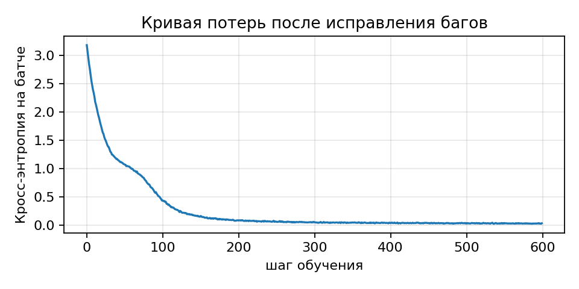

# ДЗ 1. Внимание и блок трансформера

В [dz1-attention.ipynb](dz1-attention.ipynb) реализованы `split_heads`, `merge_heads`, `scaled_dot_product_attention` и `TransformerBlock.forward`. В [dz1-bughunt.ipynb](dz1-bughunt.ipynb) исправлены три ошибки варианта с seed **42**. Оба ноутбука сохранены с выводом всех ячеек и проходят **17 из 17** проверок каждый.

## Как повторить в Google Colab

1. В Colab выберите «Файл → Загрузить блокнот» и откройте `dz1-attention.ipynb`. Выполните «Среда выполнения → Выполнить всё». В разделе «Прогон» появится результат `пройдено 17 из 17`.
2. Загрузите `dz1-bughunt.ipynb`. В меню «Среда выполнения → Сменить среду выполнения» выберите ускоритель **T4 GPU**.
3. В свежей среде выполните все ячейки сверху вниз. Проверки выполняются на CPU, а обучение и генерация используют CUDA при её наличии. Ячейка обучения печатает устройство, версии Python и PyTorch, версию CUDA и seed. Для запуска достаточно PyTorch и Matplotlib из среды Colab. Корпус задан в ноутбуке.
4. В конце появятся лог обучения, график и сгенерированный текст. График также сохраняется как `training-loss.png` в рабочем каталоге среды Colab. Его можно скачать через панель «Файлы».

## Локальный запуск и конфигурация

Сохранённый прогон выполнен на **CPU Apple M3 Pro**, macOS 15.7.3 (arm64), Python 3.12.8, PyTorch 2.11.0 и Matplotlib 3.7.5. Для локального запуска установите Python 3.12, выполните команды из корня репозитория, затем откройте каждый ноутбук в Jupyter и выполните все ячейки.

```sh
python3.12 -m venv .venv
source .venv/bin/activate
python -m pip install torch==2.11.0 matplotlib==3.7.5 notebook
jupyter notebook
```

- Seed **42** идентифицирует выданный вариант. Seed **0** задаёт инициализацию весов, выбор обучающих окон и dropout. Перед генерацией seed снова устанавливается в **0**.
- Корпус состоит из 200 повторов строки `алгоритм внимания смотрит на все позиции сразу. ` и содержит 9600 символов. Словарь строится сортировкой 19 уникальных символов. Цель сдвинута относительно входа на один символ.
- В модели 400 640 обучаемых параметров. Контекст 64 символа, `d_model=128`, 4 головы, 2 блока, `d_ff=512`, dropout 0,1. Обучение длится 600 шагов на батчах из 32 окон. Оптимизатор AdamW с `lr=3e-4`, функция потерь — кросс-энтропия.
- Генерация начинается с `а` и добавляет 200 символов при `temperature=0.8` и `top_k=10`.
- Для обучения включён детерминированный режим PyTorch. Параметр cuBLAS задаётся до инициализации CUDA. Числа и генерация могут отличаться на T4 и в других версиях библиотек. Сохранённые результаты получены на CPU.

Конфигурация эксперимента взята из выданного ноутбука. Ориентир с 62 символами в словаре и 500 шагами в общем описании задания получен на другом корпусе и модели меньшего размера.

## Отчёт об ошибках

Номера строк отсчитываются с единицы внутри ячейки с кодом модели в `dz1-bughunt.ipynb`.

| Локализация | Механизм нарушения | Исправление |
|---|---|---|
| `sinusoidal_positional_encoding`, строка 39 | Диапазон начинался с 1, поэтому позиция с индексом 0 получала код позиции 1. Аргумент синуса и косинуса сдвигался на частоту соответствующего канала. На позиции 0 синусы переставали равняться нулю, а косинусы — единице. | Индексы строятся через `torch.arange(length, dtype=torch.float32)`. |
| `LayerNorm.forward`, строки 60–61 | `dim=0` агрегировал статистики по примерам батча в фиксированной позиции и канале. При добавлении примера менялся выход остальных. При размере батча 1 числитель `x - mean` всегда обнулялся, поэтому выход нормализации содержал только обучаемый сдвиг. | Среднее и дисперсия вычисляются по последней оси (`dim=-1`), то есть по признакам внутри каждого токена. |
| `scaled_dot_product_attention`, строка 101 | `dim=-2` применял softmax по запросам для каждого ключа. Сумма весов ключей для запроса могла отличаться от 1. Знаменатель softmax включал логиты будущих запросов, и их изменение влияло на веса более ранних запросов даже при причинной маске. | Softmax применяется по ключам (`dim=-1`) после маскирования логитов. |

Исходная версия прошла 7 из 17 проверок. При изолированном возврате ошибки внимания проверка причинности тоже падает. В исходном варианте её маскировала ошибка LayerNorm, поскольку при батче из одного примера финальная нормализация делала логиты независимыми от токенов.

## Результаты обучения

| Шаг | 0 | 100 | 200 | 300 | 400 | 500 | 599 |
|---|---:|---:|---:|---:|---:|---:|---:|
| Кросс-энтропия | 3,1844 | 0,4395 | 0,0858 | 0,0581 | 0,0405 | 0,0411 | 0,0369 |



Пример из вывода последней ячейки, включая начальный символ `а`.

```text
ания смотрит на все позиции сразу. алгоритм внимания смотрит на все позиции сразу. алгоритм внимания смотрит на все позиции сразу. алгоритм внимания смотрит на все позиции сразу. алгоритм внимания смот
```

Модель восстановила повторяющуюся структуру корпуса, включая пробелы и точки. Кривая показывает потери на обучающих батчах этого корпуса.
